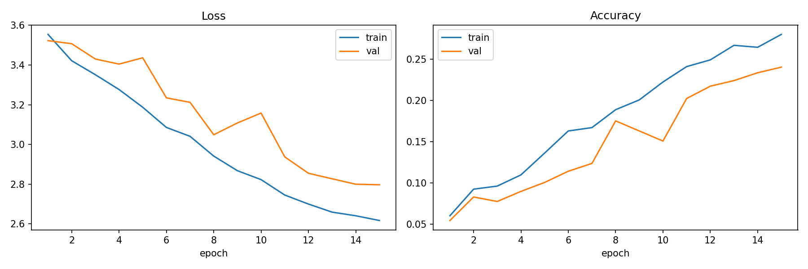
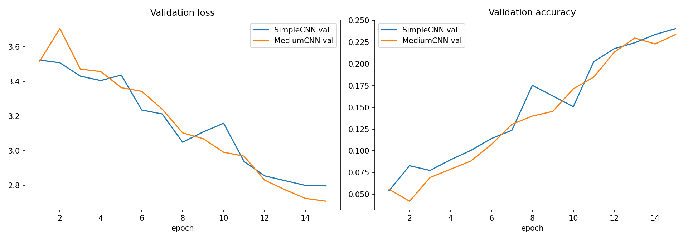

# Oxford-IIIT Pet: ცხოველთა ჯიშების ამოცნობა

End-to-End Computer Vision პროექტი (Machine Learning Engineer | Computer Vision, Talent Growth Program).

პროექტში სურათზე გამოსახული კატის ან ძაღლის ჯიშს ვარჩევ (სულ 37 ჯიში). ჯერ ნულიდან დავწერე რამდენიმე CNN, შემდეგ იგივე ამოცანა ImageNet-ზე გაწვრთნილი ResNet18-ით გადავწყვიტე, ბოლოს კი მოდელი ONNX-ში გადავიყვანე და დავაკვანტე, რომ CPU-ზე სწრაფად და მცირე ზომით მუშაობდეს.

## სარჩევი

1. [მოკლე შედეგები](#1-მოკლე-შედეგები)
2. [მონაცემები](#2-მონაცემები)
3. [პროექტის სტრუქტურა](#3-პროექტის-სტრუქტურა)
4. [ინსტალაცია](#4-ინსტალაცია)
5. [როგორ გავუშვათ](#5-როგორ-გავუშვათ)
6. [მონაცემების დამუშავება](#6-მონაცემების-დამუშავება)
7. [მოდელები](#7-მოდელები)
8. [ვარჯიშის პროცესი](#8-ვარჯიშის-პროცესი)
9. [ექსპერიმენტები](#9-ექსპერიმენტები)
10. [შეფასება და შეცდომების ანალიზი](#10-შეფასება-და-შეცდომების-ანალიზი)
11. [ოპტიმიზაცია](#11-ოპტიმიზაცია)
12. [API და დემო](#12-api-და-დემო)
13. [გაწვრთნილი მოდელის ფაილები](#13-გაწვრთნილი-მოდელის-ფაილები)
14. [ტექნიკური ანგარიში](#14-ტექნიკური-ანგარიში)
15. [AI ინსტრუმენტების გამოყენება](#15-ai-ინსტრუმენტების-გამოყენება)
16. [განმეორებადობა](#16-განმეორებადობა)

## 1. მოკლე შედეგები

| | |
|---|---|
| ამოცანა | გამოსახულებების კლასიფიკაცია, 37 კლასი |
| მონაცემები | [Oxford-IIIT Pet Dataset](https://www.robots.ox.ac.uk/~vgg/data/pets/) |
| ბიბლიოთეკა | PyTorch, torchvision |
| საუკეთესო მოდელი | ResNet18 (ImageNet-ის წონებით), Fine-Tuning |
| Test Accuracy | 89.07 % |
| Test Macro-F1 | 0.888 |
| მოდელის ზომა | 44.8 MB (FP32 ONNX) → 11.3 MB (INT8 ONNX) |
| CPU-ზე ერთი სურათის დამუშავება | დაახლოებით 31 ms → 9.6 ms |

ყველაფერი უფასო გარემოში (Colab/Kaggle ან ჩვეულებრივი კომპიუტერი) სრულდება, ფასიანი სერვისები და ძლიერი GPU საჭირო არ არის.

### რა პრობლემას წყვეტს პროექტი

ზოგიერთი ჯიში ერთმანეთს ძალიან ჰგავს (მაგალითად Staffordshire Bull Terrier და American Pit Bull Terrier, ან Ragdoll და Birman), ამიტომ მათი ავტომატური გარჩევა რთულია. ასეთ ამოცანას fine-grained classification ჰქვია. პრაქტიკაში ასეთი სისტემა შეიძლება გამოდგეს თავშესაფრებში, ვეტერინარულ აპლიკაციებში ან ფოტოების ავტომატური მარკირებისთვის.

## 2. მონაცემები

გამოვიყენე Oxford-IIIT Pet Dataset: 37 კატეგორია (12 კატის და 25 ძაღლის ჯიში), თითო კლასში დაახლოებით 200 სურათი.

| მახასიათებელი | მნიშვნელობა |
|---|---|
| კლასების რაოდენობა | 37 |
| სურათების საერთო რაოდენობა | დაახლოებით 7 349 |
| `trainval` ნაწილი | 3 680 |
| `test` ნაწილი | 3 669 |
| გამოყენებული ლეიბლი | `category` (ჯიში) |
| გადმოწერა | ავტომატურად, `torchvision.datasets.OxfordIIITPet(download=True)` |

### რატომ ავირჩიე ეს მონაცემები

- კლასები დაახლოებით თანაბრადაა წარმოდგენილი, ამიტომ Accuracy და Macro-F1 ორივე სანდო მეტრიკაა.
- ჯიშებს შორის განსხვავება მცირეა. ეს მაძლევს საშუალებას, რეალურად გავზომო, რამდენად ეხმარება Transfer Learning ასეთ ამოცანას.
- მონაცემები პატარაა და უფასო გარემოშიც კარგად ეტევა.
- torchvision-ში უკვე ჩაშენებულია, ამიტომ ნებისმიერს შეუძლია იგივე შედეგის გამეორება.

აქ მხოლოდ კლასიფიკაციის ლეიბლებს ვიყენებ. მონაცემთა ნაკრებში სეგმენტაციის (trimap) და bounding box-ის ანოტაციებიცაა, მათი გამოყენება შეიძლება შემდგომ გაუმჯობესებად (იხ. [14.6](#146-რას-გავაუმჯობესებდი)).

### Train / Validation / Test

```
trainval (3 680)  ->  train 80 % (2 944)
                      val   20 % (  736)     seed = 42
test (3 669)      ->  მხოლოდ საბოლოო შეფასებისთვის
```

train და val ერთსა და იმავე `trainval` სურათებიდან იქმნება, ოღონდ train-ზე augmentation გამოიყენება, val-ზე არა. Test ნაწილს არჩევანის გასაკეთებლად არასდროს ვიყენებდი.

## 3. პროექტის სტრუქტურა

```
.
├── src/
│   ├── data.py            # მონაცემების ჩატვირთვა, transform-ები, DataLoader-ები
│   ├── models.py          # SimpleCNN, MediumCNN, ResNetCNN, build_resnet18
│   └── train.py           # train_one_epoch, evaluate, fit
├── models/
│   ├── baseline_cnn.pth       # SimpleCNN, 15 ეპოქა
│   ├── medium_cnn.pth         # MediumCNN, 15 ეპოქა
│   ├── medium_cnn_30ep.pth    # MediumCNN, 30 ეპოქა
│   ├── resnet18_finetune.pth  # საუკეთესო მოდელი (PyTorch)
│   ├── resnet18.onnx          # ONNX, FP32
│   ├── resnet18_int8.onnx     # ONNX, INT8
│   └── classes.json           # 37 ჯიშის სახელი
├── reports/
│   ├── *_history.json         # თითო ექსპერიმენტის loss და accuracy
│   ├── test_preds.npy         # პროგნოზები Test ნაწილზე
│   ├── test_labels.npy        # რეალური ლეიბლები
│   └── figures/
│       ├── baseline_curves.png
│       └── cnn_comparison.png
├── requirements.txt
└── README.md
```

| ფაილი | რას აკეთებს |
|---|---|
| `src/data.py` | `get_transforms()` ქმნის train და eval ტრანსფორმაციებს, `get_dataloaders()` ტვირთავს მონაცემებს, ყოფს train/val-ად და აბრუნებს DataLoader-ებს |
| `src/models.py` | შეიცავს ყველა არქიტექტურას: `SimpleCNN`, `MediumCNN`, `ResBlock` + `ResNetCNN` და `build_resnet18()` |
| `src/train.py` | `train_one_epoch()`, `evaluate()` (loss, accuracy, macro-F1) და `fit()` (AdamW, Cosine LR, საუკეთესო checkpoint-ის შენახვა, არასავალდებულო W&B) |

## 4. ინსტალაცია

| ბიბლიოთეკა | რისთვის |
|---|---|
| `torch`, `torchvision` | მოდელები, მონაცემები, ვარჯიში |
| `scikit-learn` | F1, classification report, confusion matrix |
| `numpy` | პროგნოზების შენახვა და დამუშავება |
| `matplotlib` | გრაფიკები |
| `onnx`, `onnxruntime` | ექსპორტი, კვანტიზაცია, ინფერენსი |
| `Pillow` | სურათების ჩატვირთვა |
| `fastapi`, `uvicorn`, `python-multipart` | API |
| `wandb` (არასავალდებულო) | ექსპერიმენტების ტრეკინგი |

```bash
git clone https://github.com/aleko-mamukashvili/pet-breed-classifier.git
cd pet-breed-classifier

python -m venv .venv
source .venv/bin/activate        # Windows: .venv\Scripts\activate

pip install -r requirements.txt
```

GPU სავალდებულო არ არის, CPU-ზეც მუშაობს. GPU-ზე ვარჯიში უბრალოდ უფრო სწრაფია.

## 5. როგორ გავუშვათ

### 5.1 მონაცემების ჩატვირთვა

```python
from src.data import get_dataloaders

train_loader, val_loader, test_loader, classes = get_dataloaders(root="data", batch_size=32)
print(len(classes))   # 37
```

პირველ გაშვებაზე მონაცემები ავტომატურად ჩამოიტვირთება `data/` საქაღალდეში.

### 5.2 ვარჯიში

Baseline (ნულიდან დაწერილი CNN):

```python
import torch
from src.data import get_dataloaders
from src.models import SimpleCNN
from src.train import fit

device = "cuda" if torch.cuda.is_available() else "cpu"
train_loader, val_loader, test_loader, classes = get_dataloaders(augment=True)

model = SimpleCNN(num_classes=37)
history = fit(model, train_loader, val_loader, epochs=15, lr=1e-3,
              device=device, ckpt_path="models/baseline_cnn.pth")
```

ResNet18, ორ ეტაპად:

```python
from src.models import build_resnet18

# 1) backbone გაყინულია, ვწრთნით მხოლოდ ბოლო ფენას
model = build_resnet18(num_classes=37, freeze_backbone=True)
fit(model, train_loader, val_loader, epochs=8, lr=1e-3,
    device=device, ckpt_path="models/resnet18_frozen.pth")

# 2) ყველა ფენა განბლოკილია, learning rate უფრო დაბალია
for p in model.parameters():
    p.requires_grad = True
fit(model, train_loader, val_loader, epochs=8, lr=1e-4,
    device=device, ckpt_path="models/resnet18_finetune.pth")
```

### 5.3 შეფასება Test ნაწილზე

```python
import torch.nn as nn
from src.train import evaluate

model.load_state_dict(torch.load("models/resnet18_finetune.pth", map_location=device))
loss, acc, f1 = evaluate(model, test_loader, nn.CrossEntropyLoss(), device)
print(f"accuracy={acc:.4f}  macro-F1={f1:.4f}")
```

### 5.4 ახალ სურათზე გამოყენება (ONNX)

```python
import json
import numpy as np
import onnxruntime as ort
from PIL import Image
from src.data import get_transforms

classes = json.load(open("models/classes.json"))
sess = ort.InferenceSession("models/resnet18_int8.onnx", providers=["CPUExecutionProvider"])

img = Image.open("my_pet.jpg").convert("RGB")
x = get_transforms(train=False)(img).unsqueeze(0).numpy()

logits = sess.run(None, {sess.get_inputs()[0].name: x})[0][0]
probs = np.exp(logits - logits.max())
probs /= probs.sum()

for i in probs.argsort()[::-1][:3]:
    print(f"{classes[i]:30s} {probs[i]:.1%}")
```

## 6. მონაცემების დამუშავება

### Preprocessing

| ნაბიჯი | პარამეტრი | რატომ |
|---|---|---|
| Resize | 224 × 224 | ResNet18-ის სტანდარტული შესასვლელი ზომაა |
| Normalize | mean `[0.485, 0.456, 0.406]`, std `[0.229, 0.224, 0.225]` | pretrained წონები ამ სტატისტიკით გაიწვრთნა |

### Augmentation (მხოლოდ train-ზე)

| ტრანსფორმაცია | პარამეტრები | რატომ |
|---|---|---|
| `RandomResizedCrop` | `scale=(0.7, 1.0)` | ობიექტის ზომისა და პოზიციის ცვლილებას უნდა შეეგუოს |
| `RandomHorizontalFlip` | p = 0.5 | ცხოველის მიმართულება ჯიშს არ ცვლის |
| `ColorJitter` | brightness, contrast, saturation = 0.2 | განსხვავებული განათება და კამერა |

ფერების ცვლილება განზრახ მცირეა: ჯიშის გარჩევაში ბეწვის ფერი და ტექსტურა მნიშვნელოვანია, ძლიერი ცვლილება კი ამ ინფორმაციას გააფუჭებდა. ვერტიკალურ flip-საც არ ვიყენებ, რადგან ასეთი სურათები რეალურად არ გვხვდება.

### განმეორებადობა

- train/val გაყოფა `seed=42`-ით კეთდება, ამიტომ ყველა ექსპერიმენტი ერთსა და იმავე validation ნაწილზე შეიძლება შევადარო.
- val და test ტრანსფორმაციები დეტერმინისტულია (Resize და Normalize), შემთხვევითობა არ არის.

## 7. მოდელები

| მოდელი | აღწერა | პარამეტრები | ფაილის ზომა |
|---|---|---:|---:|
| SimpleCNN (baseline) | 4 ბლოკი [Conv3×3, BatchNorm, ReLU, MaxPool] (32-დან 256 არხამდე), Global Average Pooling, Dropout 0.3, Linear | დაახლოებით 0.40 M | 1.6 MB |
| MediumCNN | 5 ბლოკი (32-დან 512 არხამდე), Global Average Pooling, კლასიფიკატორი 512 → 256 → 37, Dropout 0.4 | დაახლოებით 1.71 M | 6.9 MB |
| ResNetCNN | ნულიდან დაწერილი: stem და 3 `ResBlock` skip-connection-ით | ცალკე არ გამიწვრთნია | - |
| ResNet18 (pretrained) | ImageNet-ის წონებით, `fc` ფენა შეცვლილია `Linear(512, 37)`-ით | დაახლოებით 11.2 M | 44.9 MB |

რატომ ავირჩიე ასე:

- `Conv → BatchNorm → ReLU → MaxPool` მარტივი და სტაბილური ბლოკია, baseline-ისთვის სწორედ ეს მჭირდებოდა.
- `AdaptiveAvgPool2d(1)` Flatten-ზე ნაკლებ პარამეტრს იძლევა და overfitting-ის რისკს ამცირებს.
- `ResBlock`-ში გამოსავალი `ReLU(F(x) + shortcut(x))`-ია. თუ ზომა ან არხები იცვლება, shortcut-ზე 1×1 convolution გამოიყენება.
- ResNet18 საკმარისად ზუსტიცაა და მსუბუქიც, ამიტომ CPU-ზე კარგად მუშაობს და კვანტიზაციასაც ადვილად იტანს.

## 8. ვარჯიშის პროცესი

| კომპონენტი | არჩევანი | მიზეზი |
|---|---|---|
| Loss | `CrossEntropyLoss` (არასავალდებულო `label_smoothing`) | სტანდარტული არჩევანია მრავალკლასიანი კლასიფიკაციისთვის |
| Optimizer | `AdamW`, `weight_decay=1e-4` | weight decay Adam-ზე უფრო სწორად მუშაობს |
| LR Scheduler | `CosineAnnealingLR` | learning rate ეპოქების განმავლობაში მშვიდად მცირდება |
| Batch size | 32 | ეტევა უფასო GPU-ის და CPU-ის მეხსიერებაში |
| Checkpoint | ინახება საუკეთესო val accuracy-ის ეპოქა | გვიანი ეპოქების overfitting-ს თავიდან ვიცილებ |
| მეტრიკები | loss, accuracy, macro-F1 | macro-F1 ყველა კლასს ერთნაირად ითვლის |
| ისტორია | `reports/*_history.json` | ყველა გაშვება შენახულია |

Transfer Learning ორ ეტაპად გავაკეთე:

1. **Frozen backbone.** წონები გაყინულია და მხოლოდ ბოლო ფენა ვარჯიშობს. ეს სწრაფია და pretrained feature-ებს არ აფუჭებს.
2. **Fine-Tuning.** ყველა ფენა განბლოკილია და learning rate უფრო დაბალია, რომ მოდელი კონკრეტულად ჯიშებს მოერგოს.

## 9. ექსპერიმენტები

### 9.1 შედარება (validation)

| # | ექსპერიმენტი | მიდგომა | ეპოქები | Train Acc | Val Acc | Val Loss |
|:-:|---|---|:-:|:-:|:-:|:-:|
| 1 | SimpleCNN (baseline) | ნულიდან, 4 ბლოკი | 15 | 28.0 % | 24.1 % | 2.797 |
| 2 | MediumCNN, პირველი გაშვება | ნულიდან, 5 ბლოკი | 15 | 24.4 % | 22.0 % | 2.728 |
| 3 | MediumCNN | ნულიდან, 5 ბლოკი | 15 | 24.9 % | 23.4 % | 2.709 |
| 4 | MediumCNN, უფრო ხანგრძლივი | იგივე არქიტექტურა | 30 | 38.9 % | 34.2 % | 2.224 |
| 5 | ResNet18, გაყინული backbone | Transfer Learning, მხოლოდ `fc` | 8 | 93.3 % | 88.9 % | 0.437 |
| 6 | ResNet18, Fine-Tuning | Transfer Learning, ყველა ფენა | 8 | 99.8 % | 92.1 % | 0.313 |

Val Acc არის საუკეთესო ეპოქის მნიშვნელობა, Val Loss კი ბოლო ეპოქისა.

### 9.2 გრაფიკები

| Baseline | SimpleCNN და MediumCNN |
|:-:|:-:|
|  |  |

### 9.3 რა დავინახე

**ექსპერიმენტები 1-3.** SimpleCNN-მა (0.4 M პარამეტრი) 24.1 % მიიღო, MediumCNN-მა (1.7 M) 23.4 %. ორივეს val loss დაახლოებით ერთნაირად მცირდებოდა და მრუდები 15-ე ეპოქაზეც ჯერ პლატოზე არ გასულა. ე.ი. პრობლემა მოდელის სიმძლავრეში კი არა, ვარჯიშის ხანგრძლივობასა და მონაცემების სიმცირეში იყო (კლასზე დაახლოებით 80 სასწავლო სურათი).

**ექსპერიმენტი 4.** MediumCNN-ის 30 ეპოქამდე გახანგრძლივებამ val accuracy 23.4 %-დან 34.2 %-მდე აიყვანა. train და val შორის სხვაობა მცირეა (დაახლოებით 5 პროცენტული პუნქტი), ანუ მოდელი ჯერ კიდევ underfit-ია. ამ გზით კარგ შედეგამდე მისასვლელად ძალიან ბევრი ვარჯიში დასჭირდებოდა.

**ექსპერიმენტი 5.** ResNet18-ში მხოლოდ ბოლო ფენის გაწვრთნამ 8 ეპოქაში 88.9 % მოგვცა, ანუ ნულიდან გაწვრთნილ საუკეთესო CNN-ზე (34.2 %) ბევრად მეტი. ImageNet-ის feature-ები, რომლებიც უკვე შეიცავს ბევრ ცხოველს, ამ ამოცანას თითქმის უცვლელად ერგება.

**ექსპერიმენტი 6.** ყველა ფენის განბლოკვამ კიდევ 3.3 პროცენტული პუნქტი დაამატა (88.9 %-დან 92.1 %-მდე), val loss კი 0.437-დან 0.313-მდე ჩამოვიდა. train accuracy თითქმის 100 %-ია, ამიტომ აქ უკვე ჩანს overfitting-ის ნიშნები (სხვაობა დაახლოებით 7.7 პუნქტი).

### 9.4 დასკვნა

| მიდგომა | Val Accuracy |
|---|:-:|
| ნულიდან CNN, 15 ეპოქა | 24 % |
| ნულიდან CNN, 30 ეპოქა | 34 % |
| ResNet18, გაყინული backbone | 89 % |
| ResNet18, Fine-Tuning | 92 % |

## 10. შეფასება და შეცდომების ანალიზი

### 10.1 საბოლოო შედეგი Test ნაწილზე

მოდელი: `resnet18_finetune.pth`

| მეტრიკა | მნიშვნელობა |
|---|:-:|
| სურათების რაოდენობა | 3 669 |
| Accuracy | 89.07 % |
| Macro-F1 | 0.888 |
| Val Accuracy (შესადარებლად) | 92.12 % |

Test შედეგი validation-ზე დაახლოებით 3 პუნქტით დაბალია. ეს მოსალოდნელია, რადგან checkpoint val-ის მიხედვით ავირჩიე, Test კი მოდელისთვის სრულიად უცნობი იყო.

### 10.2 ყველაზე რთული და ყველაზე ადვილი ჯიშები (F1)

| სუსტი | F1 | ძლიერი | F1 |
|---|:-:|---|:-:|
| American Pit Bull Terrier | 0.594 | Leonberger | 0.985 |
| Staffordshire Bull Terrier | 0.667 | Keeshond | 0.985 |
| Ragdoll | 0.731 | Japanese Chin | 0.975 |
| American Bulldog | 0.788 | | |
| Birman | 0.819 | | |

### 10.3 ყველაზე ხშირი აღრევები

| რეალური ჯიში | მოდელმა დაასახელა | რამდენჯერ |
|---|---|:-:|
| American Pit Bull Terrier | Staffordshire Bull Terrier | 22 |
| Ragdoll | Birman | 19 |
| American Pit Bull Terrier | American Bulldog | 15 |
| Staffordshire Bull Terrier | American Bulldog | 14 |
| Beagle | Basset Hound | 10 |
| Egyptian Mau | Bengal | 10 |
| Russian Blue | British Shorthair | 9 |
| American Pit Bull Terrier | German Shorthaired | 9 |

### 10.4 ანალიზი

შეცდომები შემთხვევითი არ არის: მოდელი თითქმის ყოველთვის ერთმანეთის მსგავს ჯიშებს ურევს. Pit Bull, Staffordshire და American Bulldog სხეულის აგებულებით და მოკლე ბეწვით ძალიან ჰგავს ერთმანეთს. Ragdoll და Birman ორივე გრძელბეწვიანი კატაა, მსგავსი შეფერილობით. ზოგიერთი ეს წყვილი ადამიანსაც ურევია.

შესაძლო მიზეზები: ლეიბლები ახლო ჯიშებს შორის ზუსტი არ არის, 224 px-ზე წვრილი დეტალები იკარგება და თითო კლასზე სასწავლო სურათები ცოტაა. ეს ჰიპოთეზებია, ცალკე არ შემიმოწმებია.


## 11. ოპტიმიზაცია

საუკეთესო მოდელი (`resnet18_finetune.pth`) ჯერ ONNX ფორმატში გადავიყვანე დინამიკური batch ზომით (`[batch, 3, 224, 224] → [batch, 37]`), შემდეგ კი INT8-ზე დავაკვანტე (`resnet18_int8.onnx`). INT8-ში წონები 32-ბიტიანი float-ის ნაცვლად 8-ბიტიან მთელ რიცხვად ინახება.

| ვარიანტი | ფორმატი | ზომა | Latency CPU-ზე (1 სურათი) | სიჩქარე |
|---|---|:-:|:-:|:-:|
| PyTorch | `.pth`, FP32 | 44.9 MB | - | - |
| ONNX | `.onnx`, FP32 | 44.8 MB | დაახლოებით 31.1 ms | 1× |
| ONNX INT8 | `.onnx`, INT8 | 11.3 MB | დაახლოებით 9.6 ms | დაახლოებით 3.3× |

Latency გავზომე `onnxruntime`-ით (`CPUExecutionProvider`), 1 CPU ბირთვზე, batch = 1, შესასვლელი 224×224, 5 გახურების და 50 საზომი გაშვების საშუალო. აბსოლუტური მნიშვნელობა კომპიუტერზეა დამოკიდებული, თუმცა დაახლოებით 3-ჯერადი სხვაობა სტაბილურია.

ზომა დაახლოებით 4-ჯერ შემცირდა (44.8 MB-დან 11.3 MB-მდე).

## 12. API და დემო

ახალ სურათზე ინფერენსი ONNX INT8 მოდელით ხდება, GPU საჭირო არ არის.

```bash
uvicorn app.main:app --host 0.0.0.0 --port 8000
```

| Endpoint | Method | აღწერა |
|---|---|---|
| `/health` | GET | სერვისის სტატუსი |
| `/predict` | POST | სურათის ატვირთვა (`multipart/form-data`, ველი `file`), პასუხად Top-3 ჯიში |
| `/docs` | GET | Swagger UI, ბრაუზერიდან გამოსაცდელად |

მაგალითი:

```bash
curl -X POST "http://localhost:8000/predict" -F "file=@my_pet.jpg"
```

```json
{
  "predictions": [
    {"breed": "Samoyed", "confidence": 0.97},
    {"breed": "Great Pyrenees", "confidence": 0.02},
    {"breed": "Keeshond", "confidence": 0.005}
  ],
  "inference_ms": 10.2
}
```

[დემოს ბმული](https://9d4768768427f9bde0.gradio.live/)

## 13. გაწვრთნილი მოდელის ფაილები

| ფაილი | დანიშნულება | ზომა |
|---|---|:-:|
| `models/resnet18_finetune.pth` | საუკეთესო PyTorch წონები (`state_dict`) | 44.9 MB |
| `models/resnet18.onnx` | ONNX, FP32 | 44.8 MB |
| `models/resnet18_int8.onnx` | ONNX, INT8 (გამოსაყენებლად) | 11.3 MB |
| `models/classes.json` | კლასების სახელები | < 1 KB |

PyTorch მოდელის ჩატვირთვა:

```python
import torch
from src.models import build_resnet18

model = build_resnet18(num_classes=37, freeze_backbone=False)
model.load_state_dict(torch.load("models/resnet18_finetune.pth", map_location="cpu"))
model.eval()
```


## 14. ტექნიკური ანგარიში

### 14.1 რა პრობლემას წყვეტს პროექტი

37 ჯიშის კატისა და ძაღლის ავტომატური ამოცნობა სურათიდან. მოდელი იმდენად მცირეა და სწრაფი, რომ CPU-ზე API-ს უკან გამოსაყენებლად ვარგა.

### 14.2 რატომ ავირჩიე ეს მონაცემები, მოდელი და მიდგომა

- **მონაცემები:** Oxford-IIIT Pet დაბალანსებულია, ზომით მისაღებია და კლასებს შორის განსხვავება რთულია, რაც ექსპერიმენტებისთვის საინტერესოა (იხ. ნაწილი 2).
- **მოდელი:** ResNet18 pretrained წონებით, მსუბუქია, CPU-ზე სწრაფია და კვანტიზაციას კარგად იტანს.
- **მიდგომა:** ჯერ ნულიდან დავწერე მარტივი baseline, რომ რიცხვებით დამენახა, რას იძლევა Transfer Learning. შედეგი 24 %-დან 89-92 %-მდე გაიზარდა.

### 14.3 რა ექსპერიმენტები ჩავატარე და რა შედეგი მივიღე

ექვსი ექსპერიმენტი ჩავატარე (ნაწილი 9). მთავარი დასკვნა: ნულიდან გაწვრთნილმა საუკეთესო CNN-მა 34.2 % მიიღო, ResNet18-მა კი 8 ეპოქაში 88.9 %, Fine-Tuning-ის შემდეგ კი 92.1 % (validation). ოპტიმიზაციამ მოდელის ზომა დაახლოებით 4-ჯერ შეამცირა და CPU-ზე დაახლოებით 3.3-ჯერ დააჩქარა.

### 14.4 რა პრობლემებს წავაწყდი და როგორ გადავჭერი

| პრობლემა | გადაწყვეტა |
|---|---|
| ნულიდან გაწვრთნილი CNN-ები ცუდად სწავლობდნენ (val დაახლოებით 22-24 %) | დავადგინე, რომ მიზეზი მონაცემთა სიმცირე და მოკლე ვარჯიშია, და გადავედი Transfer Learning-ზე |
| validation-ზე augmentation-ის ხმაური | ერთი და იგივე სურათებისთვის ორი Dataset ობიექტი გავაკეთე (train: augmentation-ით, val: უმისოდ), ერთნაირი ინდექსებით |
| გაყოფის განმეორებადობა | ფიქსირებული seed (42) და `torch.randperm` |
| pretrained ფენების დაზიანების რისკი | ორეტაპიანი ვარჯიში: ჯერ frozen, მერე ფაინ-ტიუნინგი დაბალი learning rate-ით |
| დიდი მოდელი გამოსაყენებლად | ONNX და INT8 კვანტიზაცია |
| ბოლო ეპოქების overfitting | ვინახავ საუკეთესო val accuracy-ის checkpoint-ს |

### 14.5 ძლიერი და სუსტი მხარეები

**ძლიერი მხარეები**

- პროექტი სრულია: მონაცემები, ვარჯიში, შეფასება, ოპტიმიზაცია, API.
- ყველა გაშვების ისტორია შენახულია JSON ფაილებში.
- რამდენიმე არქიტექტურა თვითონ დავწერე და ტრენინგის ციკლიც ხელით მაქვს.
- შეცდომები გავაანალიზე და ნათელია, რომელ ჯიშებს ურევს მოდელი.
- მოდელი მცირეა და GPU-ს გარეშე მუშაობს.

**სუსტი მხარეები**

- Fine-Tuning-ის train (99.8 %) და val (92.1 %) შორის სხვაობა მიანიშნებს overfitting-ზე.
- Pit Bull, Staffordshire, Ragdoll და Birman ჯიშებზე F1 დაბალია.
- ყველა ექსპერიმენტი ერთი seed-ით გავუშვი, ამიტომ საშუალო და გადახრა არ მაქვს გაზომილი.
- ნულიდან გაწვრთნილი CNN-ები სრულად არ დაკონვერგირებულა, მრუდები ჯერ კიდევ იზრდებოდა.
- მხოლოდ კლასიფიკაციაა, ობიექტის ლოკალიზაცია ან სეგმენტაცია არ ხდება.
- INT8 მოდელის სიზუსტე Test ნაწილზე ცალკე ჯერ არ გამომიცდია.

### 14.6 რას გავაუმჯობესებდი

1. მეტი რეგულარიზაცია: MixUp ან CutMix, label smoothing (`fit()`-ში უკვე არის), უფრო ძლიერი augmentation.
2. სხვა backbone-ების გამოცდა (EfficientNet-B0, ConvNeXt-Tiny) სიზუსტისა და სიჩქარის შესადარებლად.
3. Fine-Tuning-ისას ფენებისთვის სხვადასხვა learning rate და ფენების ეტაპობრივი განბლოკვა.
4. უფრო დიდი სურათის ზომა (მაგ. 288 ან 320 px), რომ წვრილი ტექსტურები უკეთ დაჩნდეს.
5. bounding box-ისა და trimap ანოტაციების გამოყენება: ჯერ ცხოველის ამოჭრა, მერე კლასიფიკაცია, რომ ფონმა ნაკლებად შეგვიშალოს ხელი.
6. Grad-CAM, რომ ვნახო, მოდელი რეალურად სურათის რომელ ნაწილს უყურებს.
7. რამდენიმე seed-ით გაშვება და შედეგების საშუალოს გამოთვლა.
8. Quantization-Aware Training, pruning ან distillation უფრო პატარა მოდელისთვის.
9. API-ს Docker-ში გაშვება და ავტომატური ტესტები.

## 15. AI ინსტრუმენტების გამოყენება


პროექტზე მუშაობისას AI ასისტენტს (Claude) ვიყენებდი. მას ვთხოვდი ცნებების ახსნას, კოდში შეცდომების პოვნას და README-ის სტრუქტურირებაში დახმარებას. არქიტექტურის არჩევანი, ექსპერიმენტების გეგმა, ჰიპერპარამეტრები და შედეგების ინტერპრეტაცია ჩემი გადაწყვეტილებებია.

მიღებულ შეთავაზებებს ვამოწმებდი ასე: კოდს ვაგდებდი და ვხედავდი, მუშაობს თუ არა; შედეგებს ვადარებდი ჩემს `history.json` ფაილებს; PyTorch-ისა და ONNX Runtime-ის დოკუმენტაციას ვადარებდი. 

## 16. განმეორებადობა

| ასპექტი | როგორ არის უზრუნველყოფილი |
|---|---|
| Random seed | `seed=42` (train/val გაყოფა) |
| მონაცემების წყარო | `torchvision.datasets.OxfordIIITPet(download=True)` |
| ვარჯიშის ისტორია | `reports/*_history.json` |
| Test პროგნოზები | `reports/test_preds.npy`, `reports/test_labels.npy` |
| კლასების თანმიმდევრობა | `models/classes.json` |
| ბიბლიოთეკების ვერსიები | `requirements.txt` |

## წყაროები

- O. M. Parkhi, A. Vedaldi, A. Zisserman, C. V. Jawahar. *Cats and Dogs*, CVPR 2012. [Dataset](https://www.robots.ox.ac.uk/~vgg/data/pets/)
- K. He et al. *Deep Residual Learning for Image Recognition*, CVPR 2016.
- I. Loshchilov, F. Hutter. *Decoupled Weight Decay Regularization* (AdamW), ICLR 2019.
- PyTorch, torchvision და ONNX Runtime დოკუმენტაცია.

---

ავტორი: ალეკო მამუკაშვილი · კონტაქტი: 598774018
